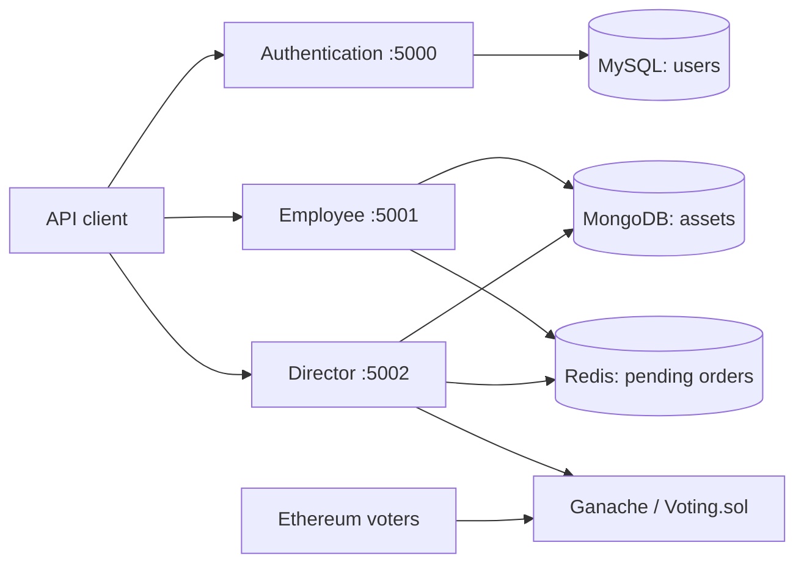

# Investment Management Platform

A backend platform for managing investment assets through employee order requests and blockchain voting. Built with Python and Flask, it separates authentication, asset operations, and director workflows into three services, backed by MySQL, MongoDB, Redis, and a Solidity smart contract.

Employees submit buy and sell orders. A director initiates a vote among designated Ethereum accounts, and the platform updates asset records when a majority approves an order.

## Features

- **Authentication and roles:** user registration, hashed passwords, and JWT authentication with employee and director permissions.
- **Asset search:** filter assets by name, category, purchase or sale date, and custom metadata.
- **Order management:** store pending buy and sell requests in Redis for director review.
- **Blockchain voting:** deploy a separate voting contract for each decision, with one vote per authorized address and a majority threshold.
- **Category reports:** aggregate purchase spending and sale proceeds from MongoDB asset records.
- **Container deployment:** Docker Compose for local development and Kubernetes manifests with three Employee replicas.

## Architecture



Authentication issues access tokens that the Employee and Director services validate using a shared JWT secret. The Director service polls active voting contracts every two seconds and applies completed decisions to the stored orders and assets.

| Component | Technology | Responsibility |
| --- | --- | --- |
| Authentication | Flask, SQLAlchemy, MySQL | User accounts, password hashing, JWT issuance |
| Employee | Flask, PyMongo, Redis | Asset queries and buy/sell requests |
| Director | Flask, Web3.py, PyMongo, Redis | Voting deployment, decision processing, reports |
| Voting contract | Solidity | Authorized voters and majority decisions |
| Local blockchain | Ganache | Development Ethereum network |
| Deployment | Docker Compose, Kubernetes | Service and infrastructure orchestration |

## Getting started

### Prerequisites

Install Docker with Docker Compose support, then clone this repository and open a terminal in its root directory.

### 1. Configure the environment

Create a `.env` file in the repository root:

```dotenv
JWT_SECRET_KEY=replace-with-a-long-random-secret
CONTRACT_OWNER_ACCOUNT=
CONTRACT_OWNER_PRIVATE_KEY=
```

Start the local blockchain and inspect its development accounts:

```bash
docker compose up -d ganache
docker compose logs ganache
```

Set `CONTRACT_OWNER_ACCOUNT` and `CONTRACT_OWNER_PRIVATE_KEY` in `.env` to a matching funded Ganache account and private key. The Director uses this account to pay for contract deployment. Use development accounts only; `.env` is excluded from version control.

### 2. Build and start the services

```bash
docker compose up --build -d
docker compose ps
```

The Director image installs Solidity compiler 0.8.20 during its build. Authentication creates its database tables and seeds the initial director account on startup.

| Service | Local URL |
| --- | --- |
| Authentication | `http://localhost:5000` |
| Employee | `http://localhost:5001` |
| Director | `http://localhost:5002` |
| Ganache JSON-RPC | `http://localhost:8545` |

These services expose API endpoints; there is no browser UI. MySQL, MongoDB, and Redis are accessible internally through the Compose network.

To inspect service logs or stop the stack:

```bash
docker compose logs -f authentication employee director
docker compose down
```

MySQL and MongoDB use named volumes that are retained by `docker compose down`.

## API walkthrough

The following examples use Bash-style `curl` commands. Replace `EMPLOYEE_TOKEN`, `DIRECTOR_TOKEN`, and other placeholders with values from your environment.

### Register and log in

New registrations receive the `employee` role. Passwords must contain at least eight characters.

```bash
curl -X POST http://localhost:5000/register \
  -H "Content-Type: application/json" \
  -d '{"forename":"Ana","surname":"Anic","email":"ana@example.com","password":"password123"}'

curl -X POST http://localhost:5000/login \
  -H "Content-Type: application/json" \
  -d '{"email":"ana@example.com","password":"password123"}'
```

Login returns an `accessToken` valid for one hour. Include it in subsequent requests as `Authorization: Bearer EMPLOYEE_TOKEN`.

### Submit a buy order

```bash
curl -X POST http://localhost:5001/create_buy_order \
  -H "Authorization: Bearer EMPLOYEE_TOKEN" \
  -H "Content-Type: application/json" \
  -d '{"name":"Example Bond","categories":["fixed-income"],"buying_price":10000,"info":{"rating":"AAA"}}'
```

A successful order request returns HTTP 200 with an empty body. The order remains in Redis until a completed vote is processed; the asset is created only after approval.

### Review orders as a director

Log in through `/login` using the seeded development account:

| Email | Password |
| --- | --- |
| `onlymoney@gmail.com` | `evenmoremoney` |

Use its `accessToken` to retrieve pending orders and their UUIDs:

```bash
curl http://localhost:5002/pending_orders \
  -H "Authorization: Bearer DIRECTOR_TOKEN"
```

### Start a vote

Replace `ORDER_UUID` with a pending order UUID and the voter placeholders with distinct, funded Ethereum addresses from your local network. The voter list must have a nonzero, odd number of entries.

```bash
curl -X POST http://localhost:5002/decision \
  -H "Authorization: Bearer DIRECTOR_TOKEN" \
  -H "Content-Type: application/json" \
  -d '{"uuid":"ORDER_UUID","voters":["VOTER_ADDRESS_1","VOTER_ADDRESS_2","VOTER_ADDRESS_3"]}'
```

The response contains `approve_transaction` and `reject_transaction` objects with `to`, `data`, and `value` fields. Each voter submits one of these through an Ethereum wallet or Web3 client connected to Ganache, signing with their authorized account and supplying the transaction's gas and fee settings.

Once either choice reaches a majority:

- An approved buy creates an asset with its purchase timestamp.
- An approved sell updates the asset with its sale price and timestamp.
- A rejected order leaves asset records unchanged.
- The completed order is removed from Redis.

### Search assets and view reports

```bash
curl -X POST http://localhost:5001/search \
  -H "Authorization: Bearer EMPLOYEE_TOKEN" \
  -H "Content-Type: application/json" \
  -d '{"name":"Bond","category":"fixed-income","info_filters":[{"field":"rating","operator":"eq","value":"AAA"}]}'

curl http://localhost:5002/report \
  -H "Authorization: Bearer DIRECTOR_TOKEN"
```

Search returns an `assets` array. Metadata filters support `eq`, `ne`, `gt`, `gte`, `lt`, and `lte`. The optional `buying_date` filter selects purchases after an ISO 8601 timestamp; `selling_date` selects sales before one.

Reports return a `statistics` array containing `category`, `spent`, and `earned`. Assets belonging to multiple categories contribute their full amounts to each category.

## API reference

| Service | Method | Endpoint | Access | Purpose |
| --- | --- | --- | --- | --- |
| Authentication | POST | `/register` | Public | Register an employee |
| Authentication | POST | `/login` | Public | Issue an access token |
| Authentication | POST | `/delete` | Authenticated user | Delete the current user |
| Employee | POST | `/search` | Employee | Search asset records |
| Employee | POST | `/create_buy_order` | Employee | Submit `name`, `categories`, `buying_price`, and `info` |
| Employee | POST | `/create_sell_order` | Employee | Submit an asset `id` and `selling_price` |
| Director | GET | `/pending_orders` | Director | List pending orders and UUIDs |
| Director | POST | `/decision` | Director | Deploy a vote for an order `uuid` and `voters` |
| Director | GET | `/report` | Director | Aggregate spending and proceeds by category |

## Running Python services locally

Each service has its own `requirements.txt` and `.env.example`. Create a virtual environment and install the dependencies for the services you want to run:

```bash
python -m venv .venv
# macOS / Linux
source .venv/bin/activate
# Windows PowerShell
# .\.venv\Scripts\Activate.ps1

pip install -r authentication/requirements.txt -r employee/requirements.txt -r director/requirements.txt
python -c "from solcx import install_solc; install_solc('0.8.20')"
```

Export the variables from the relevant `.env.example` into each service's process environment; the Python applications do not load `.env` files automatically. Use the same `JWT_SECRET_KEY` for all three services.

Provide reachable MySQL, MongoDB, Redis, and Ethereum instances. For a local MySQL instance, replace the `mysql` hostname in `DATABASE_URL` with its actual host and create the database first. The supplied Compose file does not publish database or Redis ports to the host.

Run each service in a separate terminal with the virtual environment activated:

```bash
python authentication/app.py
python employee/app.py
python director/app.py
```

Their default ports are `5000`, `5001`, and `5002`, respectively. Set `PORT` to override a service's port.

## Kubernetes

The manifests in [`kubernetes/all.yaml`](kubernetes/all.yaml) define the three application services, MySQL, MongoDB, Redis, Ganache, configuration, secrets, and persistent volume claims. The Employee deployment runs three replicas.

Build the application images:

```bash
docker build -t investment-authentication:latest -f authentication/Dockerfile .
docker build -t investment-employee:latest -f employee/Dockerfile .
docker build -t investment-director:latest -f director/Dockerfile .
```

Make these images available to your cluster, or update the manifests with registry image references. Configure the JWT and database secrets and replace the placeholder contract owner credentials with a funded account on the cluster's Ganache network. The cluster also needs storage provisioning for the MySQL and MongoDB claims.

```bash
kubectl apply -f kubernetes/
kubectl get pods
kubectl get services
```

Authentication, Employee, and Director are exposed through NodePorts `30000`, `30001`, and `30002`, respectively, subject to your cluster's networking configuration.

## Repository structure

```text
.
├── authentication/       # User accounts and JWT authentication
├── employee/             # Asset search and order creation
├── director/             # Voting orchestration and reporting
├── blockchain/
│   └── Voting.sol        # Majority-vote smart contract
├── kubernetes/
│   └── all.yaml          # Cluster resources
├── docker-compose.yml    # Local service stack
└── README.md
```

## Current scope

This repository implements a backend prototype for recording investment decisions. Approved orders update asset records; they do not execute trades through a broker or transfer investment funds on-chain.

The deployment files use development credentials and Flask's built-in server. Active voting contracts are tracked in Director process memory, so tracking does not survive a service restart. Redis and Ganache have no persistent volumes configured. These constraints should be addressed before using the platform beyond a development environment.
